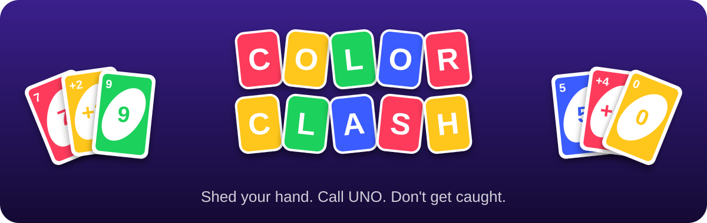

<p align="center">
  
</p>

<p align="center">
  <b>A colorful, offline card game for 2–6 Android phones.</b><br>
  One phone hosts, everyone else joins over the same Wi-Fi or the host's hotspot.<br>
  No internet, no accounts, no ads.
</p>

<p align="center">
  
  
  
  
</p>

<p align="center">
  <a href="../../releases/latest"></a>
</p>

---

## ✨ Highlights

- 🃏 **The real thing:** the full 108-card deck, a fair shuffle, and a deal that goes round the table one card at a time
- 🔴 **UNO buzzer:** always on screen, never hints when to press it. Forget, and anyone can **CATCH!** you
- 🤖 **Friends or bots:** fill empty seats with Easy or Normal bots, or practise alone on one phone
- 🏠 **House rules:** stacking, jump-in, 7-0, draw until playable, +4 challenges, a power-card finish penalty
- 💥 **Juicy table:** flying cards, stamps that slam onto whoever gets skipped or hit with a +2/+4, spoken call-outs
- 😂 **Trash talk:** emoji reactions and quick-chat bubbles that pop out of your seat
- 🖼️ **Make it yours:** use a photo or one of 50 avatars (animals plus Malayalam, Tamil and English film
  characters), add a color and a frame, and pick your own table color and card back
- ⏭️ **Keeps moving:** a turn timer, the next round starting by itself, and **Play again** for a rematch
- 🎛️ **Your way:** sort your hand by color or number, tap-twice-to-play, colorblind shapes on every card,
  and your wins and best round in Settings
- 📶 **Built for a room full of phones:** join by QR or room code, rejoin after a dropped connection,
  and a bot keeps your seat warm if you're gone too long

## 🎮 How to play

1. **Install** the [latest APK](../../releases/latest) on every phone (they all need the same version).
2. **Host:** one phone taps **Host a game**. Everyone joins the host's Wi-Fi, or the host turns on their
   hotspot from the lobby.
3. **Join:** everyone else taps **Join a game** and scans the QR code or types the room code.
4. **Start:** players tap **I'm ready**, the host picks the house rules and taps **Start game**.

Match the top card by **color** or **number**, or play a wild. First to empty their hand wins the round
and scores the cards left in everyone else's hands. Play to 100, 250 or 500 points, or just one round.

| Card | What it does |
| --- | --- |
| **0–9** | Match by color or number. Scores its face value |
| **Skip** | The next player loses their turn. Scores 20 |
| **Reverse** | Flips the direction of play (with two players it works like Skip). Scores 20 |
| **+2** | The next player draws 2 and misses their turn. Scores 20 |
| **Wild** | Pick the next color. Scores 50 |
| **Wild +4** | Pick the color; the next player draws 4 and misses their turn. If you played it while holding the color in play, they can challenge you. Scores 50 |

On your turn, hit **UNO!** before playing your second-to-last card. Every turn has a 15-second timer
(the host can change it); run out three times in a row and a bot plays for you until you tap **I'm back**.

Coming from a build before 1.0.0? Uninstall it first: those were signed with a temporary key, so
Android won't update them. From 1.0.0 on, new versions install over the top.

<details>
<summary><b>🏠 House rules</b></summary>

| Rule | What changes |
| --- | --- |
| Stack +2 / +4 | Pass a draw penalty along by playing another +2 or +4 on it |
| Jump in | Play an identical card (same color and number) even when it's not your turn |
| 7-0 | A 7 swaps hands with a player you pick; a 0 passes every hand along |
| Draw till playable | Keep drawing until you get a card you can play |
| Challenge +4 | Call out a Wild +4 played while its owner had the color in play |
| Power finish | Going out on a Skip, Reverse, +2 or wild makes you draw 2 or 4 instead of winning |

The host's phone remembers these for the next room it opens.
</details>

<details>
<summary><b>🛠️ Troubleshooting</b></summary>

| Problem | Try |
| --- | --- |
| Room doesn't show under *Rooms nearby* | Normal on many routers, which block discovery. Scan the QR or type the room code. |
| "Couldn't reach the host" on a shared Wi-Fi | Guest and office networks often stop phones talking to each other. Use the host's hotspot. |
| Joined the hotspot but can't connect | Make sure the phone stayed on the hotspot (some hop to mobile data when Wi-Fi has no internet), then type the room code. |
| Joining by IP address | On the host, tap the QR to enlarge it; the IP and port are underneath. |
| Host's game stops when its screen is off | Some makers (Samsung, Xiaomi, OnePlus, Huawei…) kill background apps hard. On the host set battery usage to **Unrestricted**: Settings › Apps › Color Clash › Battery. See [dontkillmyapp.com](https://dontkillmyapp.com). |
| Someone's app was closed mid-game | Open it again and tap **Rejoin game**. Within 60 s nobody notices; after that a bot was keeping the seat warm. |
| "Install the same build on every phone" | Everyone needs the same version. |
| "App not installed" when updating | The installed copy is from before 1.0.0 (signed with a different key). Uninstall it, then install. |
| The host's app was closed | The game can't move to another phone; start a new room. |

On Android 17 and newer the app asks for permission to talk to devices on your local network the first
time you host or join; the game can't work without it. Before a big game night, run through the
[device test checklist](docs/DEVICE_TESTING.md) once with your phones.
</details>

## 🏗️ How it works

The host phone runs the whole game; the other phones only send what their player wants to do
("play this card", "draw") and show what the host sends back. The host never sends anyone another
player's cards and checks every move against the rules.

| Module | What's in it |
| --- | --- |
| `:rules` | The game itself: a pure `(state, action) -> (new state, events)` reducer, the bots, a seedable RNG. Plain Kotlin. |
| `:protocol` | The JSON messages between phones and each player's redacted view of the game. |
| `:net` | The Ktor WebSocket host (seats, reconnects, bots, turn timer, photos) and client (heartbeat, auto-reconnect). |
| `:app` | The Android app: Compose UI and animations, sound and voice, the service that keeps the host alive, Wi-Fi and mDNS. |

<details>
<summary><b>🧑‍💻 Building from source</b></summary>

Needs JDK 17 or newer (21 recommended) and the Android SDK. Gradle comes with the wrapper.

```bash
./gradlew test                    # unit, fuzz and integration tests
./gradlew :app:assembleDebug      # app/build/outputs/apk/debug/app-debug.apk
./gradlew :app:assembleRelease    # signed if the release key is set up (below)
```

Install on a USB-connected phone with `adb install -r app/build/outputs/apk/debug/app-debug.apk`.
Fuzz the rules harder with `./gradlew :rules:test -PfuzzGames=20000`.
</details>

<details>
<summary><b>📦 Releases and signing</b></summary>

The [`Build APK`](.github/workflows/release.yml) workflow runs the tests and lint and builds a signed
APK on every push to `main` and every pull request (download it from the run's artifacts).

To publish a version, tag `main` and push the tag. The build is named after the tag and published as a
GitHub Release with the APK attached:

```bash
git tag v1.0.1 && git push origin v1.0.1
```

Android only installs an update over an existing copy signed with the same key, so CI signs with a
permanent key kept in four repository secrets (already set up). To set it up again:

1. Make a key. `keytool` comes with Android Studio (`jbr\bin\keytool.exe`) or any JDK:
   ```bash
   keytool -genkeypair -v -keystore color-clash-release.jks -alias colorclash -keyalg RSA -keysize 2048 -validity 10000
   ```
2. Turn it into base64 text:
   - PowerShell: `[Convert]::ToBase64String([IO.File]::ReadAllBytes("color-clash-release.jks")) | Set-Content color-clash-release.b64`
   - macOS/Linux: `base64 -w0 color-clash-release.jks > color-clash-release.b64` (macOS: `base64 -i … -o …`)
3. Add the secrets under Settings › Secrets and variables › Actions, or with the GitHub CLI from inside
   the project folder:
   ```powershell
   Get-Content color-clash-release.b64 -Raw | gh secret set KEYSTORE_BASE64
   gh secret set KEYSTORE_PASSWORD
   gh secret set KEY_ALIAS --body colorclash
   gh secret set KEY_PASSWORD
   ```

Keep the `.jks` and its password somewhere safe outside the repo: losing them means everyone has to
uninstall before they can update. Without the secrets, CI signs with a throwaway key and refuses to
publish a release. To sign locally, export `CC_KEYSTORE_PATH`, `CC_KEYSTORE_PASSWORD`, `CC_KEY_ALIAS`
and `CC_KEY_PASSWORD` before `assembleRelease`.
</details>

## 🙏 Credits

Cards, effects and the logo are drawn in code; sounds and music were made for this game and are free to
reuse (CC0). See [ASSETS.md](ASSETS.md). A private project for playing with friends, not published anywhere.
